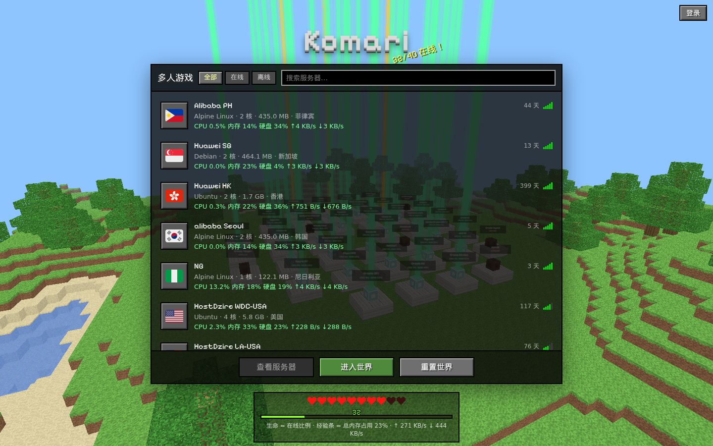

# Blockworld

[Komari](https://github.com/komari-monitor/komari) 监控主题，方块游戏风格：首页背景是一个**可以走进去的 3D 方块世界**。

- **每台服务器是一座信标塔**：在线时射出光柱，颜色随负载变化（绿 / 黄 / 红）；离线则熄灭。塔上方的名牌显示名字和 CPU、内存占用。
- **可以玩**：点“进入世界”后 WASD 走动、空格跳跃、双击空格或 F 飞行，左键破坏、右键放置，1-9 或滚轮选方块。搭建的内容保存在浏览器里。
- **在世界里看监控**：对着信标塔右键或按 E，打开这台服务器的“箱子”界面。
- **多人游戏列表**：不进世界也能看全部监控——每台服务器一行，带信号格、占用和实时网速；底部的生命值是在线比例，经验条是总内存占用。
- 节点详情页含负载图表、延迟图表和三网回程。

世界、贴图全部由代码在浏览器里生成，仓库不包含任何游戏素材。手机和没有鼠标的设备只显示世界全景与列表，不提供“进入世界”。

## 安装

在 Komari 后台 → 主题 中上传 [Releases](https://github.com/wugan666/komari-theme-blockworld/releases) 里的 zip。

## 主题设置

启用 3D 世界、世界时间（白天 / 夜晚）、世界种子、数据刷新间隔、RPC 连接模式、是否隐藏后台入口。

## 声明

非官方的同人风格作品，与 Mojang Studios、Microsoft 没有任何关系，未使用其素材。

数据层与图表来自 [komari-theme-liquidbounce](https://github.com/wugan666/komari-theme-liquidbounce)（源自 Tokinx 的 komari-theme-emerald，MIT）；3D 渲染使用 [three.js](https://threejs.org)，像素字体为 [Pixelify Sans](https://github.com/eifetx/Pixelify-Sans)（OFL）。
